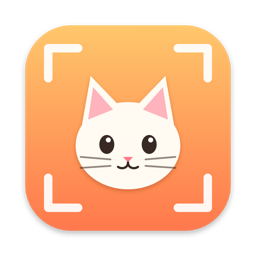
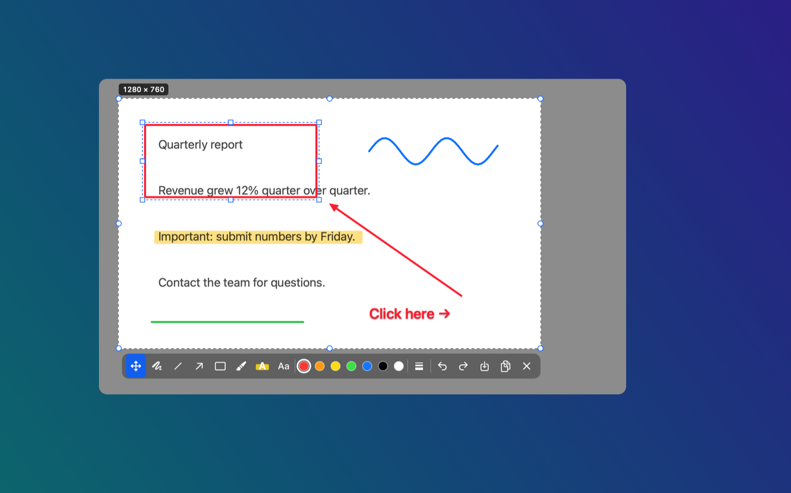
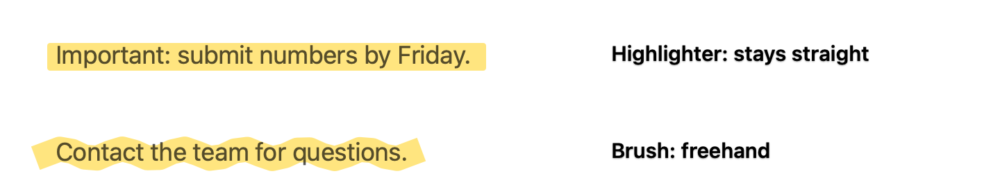
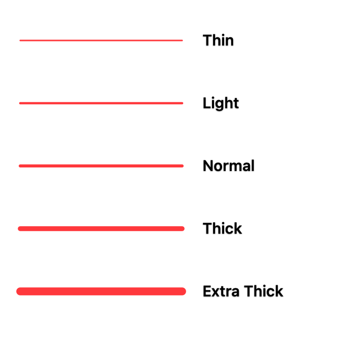

<div align="center">



# MaoShot

**A fast, free screenshot tool for macOS with built-in markup.**
Press a shortcut, drag an area, mark it up, copy or save.

[](https://github.com/betterdev4u/maoshot/releases/latest)
[](LICENSE)


[Download](https://github.com/betterdev4u/maoshot/releases/latest) · [Install](#install) · [Usage](#usage) · [Troubleshooting](#troubleshooting) · [Contributing](CONTRIBUTING.md)



</div>

MaoShot (猫 *māo* = cat) is a [Lightshot](https://app.prntscr.com)-style capture tool that lives in the menu bar. It is a native Swift app: universal binary (Apple Silicon and Intel), no dependencies, no account, no network access, nothing leaves your Mac.

## Features

- **Capture:** global shortcut (default **⇧⌘2**, or record your own), drag any area, resize and move it before you commit.
- **Markup:** pen, line, arrow, rectangle, text, a freehand brush, and a **straight highlighter** for text.
- **Five thickness levels:** thin to extra thick, changed by scroll wheel, `[` / `]`, or the toolbar.
- **Editable marks:** click any mark to move, resize, recolour or delete it. Full undo and redo.
- **Copy or save:** Return copies to the clipboard, ⌘S saves a PNG. Retina resolution, cursor hidden.
- **Recent captures:** the last 10 are kept, even ones you closed without saving.
- **Multi-display**, launch at login, PrintScreen-style shortcut support.

<table>
<tr>
<td width="50%"><br><sub><b>Highlighter</b> stays on one line as you drag, for clean text highlights. <b>Brush</b> is freehand.</sub></td>
<td width="50%"><br><sub><b>Thickness</b> from Thin to Extra Thick. Normal is the default.</sub></td>
</tr>
</table>

## Install

### Option 1: Download (recommended)

1. Download `MaoShot-<version>.zip` from the [latest release](https://github.com/betterdev4u/maoshot/releases/latest) and unzip it.
2. Move **MaoShot.app** to **/Applications**.
3. The first launch is blocked because MaoShot is not notarized (that needs a paid Apple Developer account). Allow it once, either way:
   - Try to open it, then go to **System Settings → Privacy & Security**, scroll down and click **Open Anyway**.
   - Or run `xattr -dr com.apple.quarantine /Applications/MaoShot.app` in Terminal, then open it.
4. Allow screen capture (see [Screen Recording permission](#screen-recording-permission)).

### Option 2: Build from source

You need macOS 14+ and the Xcode Command Line Tools (`xcode-select --install`) or Xcode 15+. Swift 5.9 or later.

```bash
git clone https://github.com/betterdev4u/maoshot.git
cd maoshot
./build.sh install     # builds a universal app, copies it to /Applications, launches it
```

Other build targets:

```bash
./build.sh             # build/MaoShot.app only
./build.sh dist        # build/MaoShot-<version>.zip for sharing
swift test             # unit tests
```

### Screen Recording permission

macOS requires your approval before any app can capture the screen.

1. On first launch MaoShot shows a setup window. Click **Open System Settings**.
2. Turn **MaoShot** on under **Privacy & Security → Screen & System Audio Recording**.
3. MaoShot restarts by itself and is ready. Look for the cat in the menu bar.

If MaoShot isn't in the list, click **Show in Finder** in the setup window and drag the app into the list.

> **Updating a build you compiled yourself:** without an Apple developer certificate the app is signed ad-hoc, and macOS treats every rebuild as a new app. After updating, use menu bar → **Troubleshoot → Reset Screen Recording Permission…** and turn MaoShot on again. If your keychain has an *Apple Development* certificate (a free Apple ID in Xcode is enough), `build.sh` uses it automatically and the permission survives updates.

### Uninstall

```bash
pkill -x MaoShot
rm -rf /Applications/MaoShot.app ~/Library/Application\ Support/MaoShot ~/Library/Logs/MaoShot.log
defaults delete com.maoshot.app
tccutil reset ScreenCapture com.maoshot.app
```

## Usage

Press **⇧⌘2**, drag the area you want, then annotate. The toolbar appears under the selection.

| Action | How |
|---|---|
| Capture | **⇧⌘2**. Change it in menu bar → **Shortcut**, or choose **Custom Shortcut…** and press any combo |
| Move or resize the area | drag it, or drag the edge handles |
| Tools: Select · Pen · Line · Arrow · Rectangle · Brush · Highlighter · Text | **V · P · L · A · R · B · H · T** |
| Thickness | scroll while a drawing tool is active, **[** / **]**, or the toolbar button. Also resizes a picked mark |
| Highlight text in a straight line | **Highlighter (H)**: drag along the text |
| Snap a line or arrow to 45° | hold **⇧** |
| Edit a mark | Select tool, click the mark. Drag to move, drag handles to resize (⇧ keeps proportions), arrow keys to nudge, Delete to remove, click a colour to recolour |
| Undo · Redo | **⌘Z** · **⇧⌘Z** |
| Copy and close | **Return**, **⌘C**, or double-click the area |
| Save to a file | **⌘S** |
| Cancel | **Esc** |

**Recent:** menu bar → **Recent** → Copy, Save, Open, or Show in Finder.

**PrintScreen-style capture:** choose **F13** under Shortcut, or turn off macOS's own ⇧⌘3/4/5 (System Settings → Keyboard → Keyboard Shortcuts → Screenshots) and record that combo as your custom shortcut. macOS gets those keys first otherwise.

## Troubleshooting

| Problem | Fix |
|---|---|
| Shortcut does nothing | Another app may own it: the menu shows a ⚠︎ warning. Pick another under Shortcut. |
| "macOS blocked the capture" | Screen Recording is off or stale. Menu bar → **Troubleshoot → Screen Recording Setup…**, or **Reset Screen Recording Permission…** if the switch is already on. |
| Cat icon missing from the menu bar | It may be hidden behind the notch or by a menu bar manager. Free space by quitting other menu bar apps. |
| Need to report a bug | Menu bar → **Troubleshoot → Copy Diagnostics Report**, and attach `~/Library/Logs/MaoShot.log`. |

## Privacy

MaoShot makes no network requests and collects nothing. Captures stay on your Mac: the last 10 are kept in `~/Library/Application Support/MaoShot/History` (clear them with menu bar → **Clear History…**).

## Contributing

Bug reports and pull requests are welcome. See [CONTRIBUTING.md](CONTRIBUTING.md). Project layout:

```
Sources/MaoShotCore/   drawing, geometry, history (no UI, unit-tested)
Sources/MaoShot/       AppKit app: menu bar, overlay, toolbar, hotkey, permission guide
Tests/                 unit tests for the core
build.sh               build, install and package script
```

`swift run MaoShot --render-demo docs/images-out` renders the overlay UI to PNGs without any permission, which is how the screenshots above are made.

## License

[MIT](LICENSE). Free to use, modify and share, including commercially.
